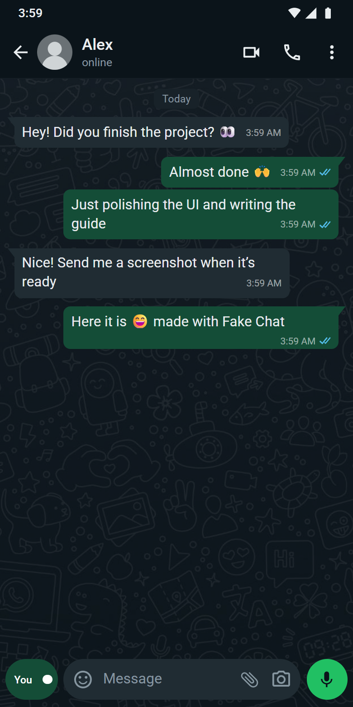
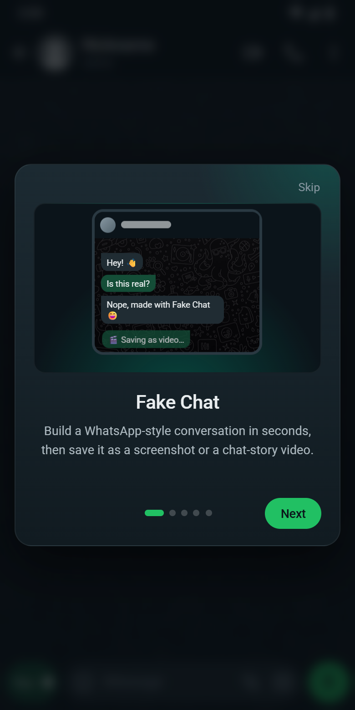

<h1 align="center">💬 Fake Chat</h1>

<p align="center">
  Build WhatsApp-style conversations in your browser, then export them as <b>screenshots</b> or <b>chat-story videos</b>.
  <br/><br/>
  <a href="https://amirphenomenal.github.io/fake-chat/"><b>▶ Open the live app</b></a>
  <br/><br/>
  
  
  <a href="https://github.com/AmirPhenomenal/fake-chat/actions/workflows/deploy.yml"></a>
  <a href="https://amirphenomenal.github.io/fake-chat/"></a>
</p>

<p align="center">
  
  &nbsp;&nbsp;
  
</p>

---

## ✨ Features

- **Looks like the real app**: WhatsApp's Android dark theme with Roboto (the font WhatsApp uses on Android), Material icons, bubble tails, timestamps, blue ticks, a "Today" chip and the mic/send button.
- **Image messages**: send photos (with optional captions) that look like real WhatsApp image bubbles. They show up in screenshots and videos too.
- **Voice notes**: hold the mic to fake a WhatsApp voice message (timer while you hold, static play + waveform bubble when you release).
- **Two people talking**: send messages as *You* (right, green) or *Them* (left, grey).
- **Editable contact**: change the profile picture, name and status line.
- **Screenshot export**: saves a sharp PNG of the chat.
- **Video export**: plays the conversation one message at a time as a smooth 30 fps MP4 with message sounds, ready for chat-story content.
- **Clean exports**: editor-only controls (sender switch, hints, menus) never appear in screenshots or videos.
- **Built-in guide**: an animated walkthrough on first visit. Reopen it anytime from the menu.

## 📖 How to use

| I want to… | Do this |
| --- | --- |
| Change the contact's photo | Click the round profile picture at the top. |
| Change the name / status | Click the name or the "online" text and type. Clear the status to hide it. |
| Change the phone clock | Click the time in the top-left corner and type. |
| Send a message | Type in the bottom box and press **Enter** or the green button. **Shift + Enter** adds a new line. |
| Send an image | Click the **📎** or **camera** icon, or paste (Ctrl+V) / drag an image onto the chat. Any text in the box becomes the caption. |
| Send a voice note | With an empty message box, **hold** the green mic button. Release to send (ignored under 0.5s, caps at 60s). Play is visual only. |
| Send a message from the **other person** | Click the **You / Them** switch next to the input before sending. |
| Add chatbot quick replies | Switch to **Them**, type the bot message, then fill the **Quick replies** box (one per line, up to three). Send. Tap a chip to add that text as a message from you. |
| Move an existing message to the other side | **Double-click** (or double-tap) the bubble. |
| Take a screenshot | **⋮** menu → **Take screenshot**. |
| Make a video | **⋮** menu → **Save video**. Keep the tab open until it downloads (you can cancel anytime). |
| Watch the chat play back | **⋮** menu → **Replay chat** (one message every 2 seconds). |
| Start over | **⋮** menu → **Clear chat**. |
| See the guide again | **⋮** menu → **How to use**. |

> **Video format:** videos are built frame by frame at a smooth 30 fps, with a sound for every message (a different one for sent and received). They save as **MP4** (H.264 + AAC) in Chrome, Edge and Safari, and as WebM in browsers without an H.264 encoder.

> **Tip:** for a phone-shaped export on desktop, keep the browser window wider than it is tall. The app then shows a 9:16 phone frame.

## 🛠️ Run it locally

Requires [Node.js](https://nodejs.org/) 18 or newer.

```sh
git clone https://github.com/AmirPhenomenal/fake-chat.git
cd fake-chat
npm install
npm start          # dev server at http://localhost:3000
```

| Command | What it does |
| --- | --- |
| `npm start` / `npm run dev` | Start the dev server with hot reload |
| `npm run build` | Production build into `build/` |
| `npm run preview` | Serve the production build locally |

## 🚀 Deployment

**Live app:** https://amirphenomenal.github.io/fake-chat/

The app is a static site (no server, no database). Everything, including video encoding, runs in the visitor's browser, and nothing they create is uploaded anywhere.

It is hosted on **GitHub Pages** and deployed by [`.github/workflows/deploy.yml`](.github/workflows/deploy.yml):

1. Every push to `main` (or a manual run from the **Actions** tab) starts the workflow.
2. It installs dependencies with `npm ci` on Node 24 and runs `npm run build`.
3. The `build/` folder is uploaded and published to GitHub Pages.

The build uses relative paths (`base: "./"` in [`vite.config.js`](vite.config.js)), so it works at any URL or sub-folder without changes.

### Deploy your own copy

1. Fork this repository.
2. Go to **Settings → Pages → Build and deployment** and set **Source** to **GitHub Actions**.
3. Push a commit to `main`, or open **Actions → Deploy to GitHub Pages → Run workflow**.
4. Your copy goes live at `https://<your-username>.github.io/fake-chat/`.

To host it somewhere else, run `npm run build` and upload the `build/` folder to any static host (Netlify, Cloudflare Pages, Vercel, nginx, …).

## 🗂️ Project structure

```
src/
├── App.jsx                 # app state + layout
├── utils.js                # ids, time, image loading, export helpers
├── video.js                # frame-by-frame video renderer (WebCodecs)
├── sounds.js               # send / receive message sounds
└── components/
    ├── AppBar/             # contact photo, name, status, menu button
    ├── ChatScreen/         # message list, input bar, You/Them switch
    ├── ChatMessage/        # a text or image bubble (double-click to flip)
    ├── Menu/               # screenshot, video, replay, clear, guide
    ├── Help/               # animated onboarding guide
    ├── Loading/            # video progress + cancel
    └── Icons.jsx           # WhatsApp-style SVG icons
```

## 🤝 Contributing

Issues and pull requests are welcome. Please open an issue first for big changes.

---

<p align="center"><sub>Not affiliated with WhatsApp or Meta. Made for fun, stories and mockups. Please don't use it to deceive people.</sub></p>
